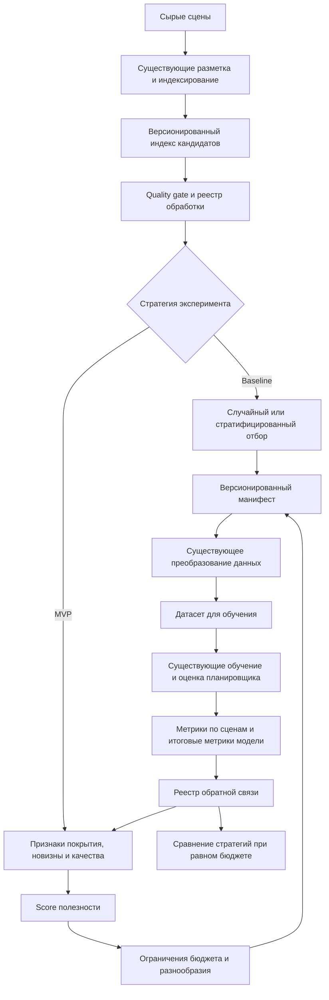

# Дизайн ML-системы отбора данных для обучения планировщика — MVP 1

| Поле | Значение |
| --- | --- |
| Версия | 0.1 |
| Статус | Draft |
| Последнее обновление | 2026-10-17 |

## 1. Цели и предпосылки

### 1.1. Зачем идем в разработку продукта?

#### Бизнес-проблема

Объем сырых сцен движения растет быстрее доступного бюджета на их подготовку и
последующее обучение модели. Каждая сцена должна пройти ресурсоемкое преобразование в
формат обучающего датасета. Полная обработка всех накопленных данных занимает слишком
много времени и вычислительных ресурсов.

Текущий алгоритмический отбор обеспечивает базовое покрытие известных типов ситуаций,
но не учитывает слабые места последней версии модели и может повторно выбирать похожие
сцены. В результате часть бюджета расходуется на данные с низкой дополнительной
ценностью, а редкие и сложные ситуации могут быть представлены недостаточно.

#### Пользователи

Основные пользователи — ML-инженеры, которые формируют обучающие выборки, запускают
обучение моделей планирования и анализируют их качество.

#### Почему станет лучше с ML

Система будет оценивать относительную полезность кандидатов и выбирать набор с учетом
качества, редкости, новизны, разнообразия и стоимости обработки. По мере накопления
обратной связи эвристическую оценку можно дополнить моделью ранжирования, обученной на
фактических ошибках планировщика.

#### Критерий успеха

Главный критерий — улучшение целевых метрик планировщика на независимой тестовой
выборке при одинаковом бюджете на подготовку данных. Альтернативная формулировка —
сохранение качества при меньших затратах на подготовку.

MVP должен устойчиво превосходить два baseline:

1. случайный отбор;
2. стратифицированный отбор с балансировкой по известным группам сцен.

Численный порог улучшения будет установлен после измерения текущего baseline и
стоимости полного цикла. На этапе первой домашней работы фиксируется способ измерения,
а не неподтвержденное целевое значение.

### 1.2. Бизнес-требования и ограничения

#### Функциональные требования

Система должна:

1. Получать версионированный индекс доступных сцен-кандидатов.
2. Исключать некорректные, уже выбранные и уже обработанные сцены.
3. Рассчитывать оценку полезности без запуска полной подготовки сцены.
4. Формировать набор в пределах заданного вычислительного бюджета.
5. Ограничивать число близких сцен и поддерживать покрытие приоритетных групп.
6. Выпускать версионированный манифест, совместимый с существующим процессом
   преобразования данных.
7. Сохранять версию входных данных, признаков, алгоритма и параметров запуска.
8. Записывать интерпретируемые причины выбора каждой сцены.
9. Принимать обратную связь после преобразования, обучения и оценки модели.
10. Резервировать часть бюджета для случайной контрольной выборки, чтобы измерять
    смещение отбора и находить неизвестные типы сцен.

#### Нефункциональные требования

- Повторный запуск с одинаковыми входами и параметрами должен давать одинаковый
  результат.
- Операция формирования манифеста должна быть идемпотентной.
- Исходные данные не изменяются системой отбора.
- Схемы входных и выходных данных должны иметь версии и автоматические проверки.
- Для каждой выбранной сцены должна восстанавливаться причина включения.
- Публичный репозиторий не должен содержать исходные данные, модели, учетные данные,
  закрытые адреса или локальные конфигурации.

#### Ограничения

- Точную функцию потерь основной модели нельзя вычислить для неподготовленной сцены.
- Обратная связь появляется с задержкой — после подготовки сцены и запуска модели.
- Измерять точный вклад одной сцены через отдельное переобучение слишком дорого.
- Первая версия ограничена признаками, уже доступными в индексе кандидатов.
- Стоимость обработки может различаться между сценами.
- Последовательные сцены одного заезда могут быть сильно коррелированы.
- Алгоритм отбора меняет распределение накопленного датасета и создает selection bias.
- Существующие процессы индексирования, преобразования и обучения имеют фиксированные
  контракты и не изменяются в рамках проекта.
- Исходные данные являются закрытыми и не публикуются.

#### Ожидаемый результат итерации

Результат — воспроизводимый прототип пакетного отбора, который читает индекс
кандидатов, ведет историю их обработки, выпускает совместимый манифест и позволяет
сравнить стратегии на исторических данных.

#### Пилот и критерии его успеха

Пилот проводится offline на нескольких последовательных временных периодах. Для
случайного baseline, стратифицированного baseline и MVP формируются выборки одинаковой
стоимости. Далее используется одна и та же процедура подготовки, обучения и оценки.

Пилот считается успешным, если MVP:

- улучшает основную метрику планировщика при фиксированном бюджете либо достигает
  качества baseline с меньшей стоимостью;
- не ухудшает критические метрики безопасности и качества данных;
- уменьшает долю близких дубликатов;
- сохраняет заданное покрытие приоритетных групп;
- не выбирает повторно уже обработанные сцены;
- позволяет объяснить причины выбора и воспроизвести манифест.

### 1.3. Что входит в скоуп проекта и первой итерации

#### Входит в скоуп

- реестр сцен-кандидатов и история их обработки;
- загрузка признаков из существующего индекса;
- фильтрация некорректных и уже обработанных сцен;
- случайный и стратифицированный baseline;
- эвристический score по редкости, покрытию, новизне, качеству и разнообразию;
- ограничения на бюджет и число близких сцен;
- случайная контрольная часть выборки;
- версионированный манифест для существующего преобразования данных;
- reason codes и компоненты score для объяснения результата;
- сбор доступной обратной связи по подготовленным сценам;
- offline-сравнение стратегий отбора.

#### Не входит в скоуп

- изменение логики существующего индексирования и семантического описания сцен;
- изменение конвертера или формата подготовленного датасета;
- разработка нового фреймворка обучения;
- изменение архитектуры ML-планировщика;
- выбор управляющего действия в реальном времени;
- развертывание online-сервиса в первой итерации;
- сбор новых сырых данных и ручная разметка;
- публикация закрытых данных, моделей и внутренних конфигураций.

#### Качество кода и воспроизводимость

- параметры запуска хранятся как конфигурация;
- входной индекс, признаки, scorer и манифест имеют версии;
- детерминированные операции используют зафиксированный seed;
- проверки качества данных выполняются до расчета score;
- ключевая логика покрывается unit- и интеграционными тестами;
- линтинг и форматирование выполняются Ruff;
- обязательные проверки запускаются через pre-commit;
- каждый эксперимент сохраняет бюджет, разбиение данных и итоговые метрики.

#### Планируемый технический долг

- первая версия использует эвристический score вместо обучаемого ранжирования;
- стоимость сцены сначала может считаться постоянной;
- периодичность запусков задается конфигурацией без автоматического планировщика;
- мониторинг drift и автоматическое дообучение scorer откладываются;
- online-интерфейс и эксплуатационные SLA будут определены после offline-пилота.

### 1.4. Предпосылки решения

1. Единица отбора — одна сцена со стабильным обезличенным идентификатором.
2. До дорогой подготовки доступны признаки качества, семантические категории,
   траекторные характеристики и принадлежность к группе похожих сцен.
3. Существующий процесс принимает список выбранных сцен и формирует датасет для модели.
4. Существующий фреймворк может рассчитать метрики для отдельных подготовленных сцен.
5. Высокая ошибка, редкость или отличие от накопленного распределения могут быть
   признаками полезной сцены, но эта связь требует экспериментальной проверки.
6. Высокая ошибка также может означать поврежденные данные, поэтому quality gate
   применяется раньше оценки сложности.
7. Связанные сцены разделяются по заезду и времени, чтобы избежать утечки между train,
   validation и test.
8. Итоговая полезность стратегии определяется качеством переобученной модели, а не
   только качеством proxy-score.
9. Подготовленный датасет, модель и scorer всегда рассматриваются вместе с их версиями.
10. Первая гипотеза по режиму работы: обновлять реестр по мере поступления данных,
    пересчитывать score пакетно каждый день, формировать бюджет ежедневно или еженедельно
    и полностью пересчитывать оценки при смене модели или схемы признаков.

## 2. Методология

### 2.1. Постановка задачи

#### Объект, вход и выход

Объект — сцена-кандидат до полной подготовки. Входные признаки первой итерации:

- семантические категории сцены;
- траекторные характеристики и группа похожих траекторий;
- расстояние до типичного представителя группы, если оно доступно;
- признаки качества;
- частота похожих сцен в уже подготовленном датасете;
- время поступления и история предыдущих решений;
- оценка стоимости обработки.

Выход — ранжированный и версионированный манифест выбранных сцен с итоговым score,
компонентами score и reason codes.

#### Формализация

Задача формулируется как constrained ranking и выбор подмножества. Для сцены \(i\):

- \(x_i\) — доступные до подготовки признаки;
- \(c_i\) — оценка стоимости обработки;
- \(u_i\) — ожидаемая полезность;
- \(s_i\) — score алгоритма.

Необходимо выбрать множество \(S\):

\[
\max_S \sum_{i \in S} u_i, \qquad
\sum_{i \in S} c_i \leq B,
\]

где \(B\) — доступный бюджет. Дополнительно задаются квоты покрытия и ограничения на
число близких или связанных сцен.

Score MVP может иметь вид:

\[
s_i =
w_1 \cdot coverage_i +
w_2 \cdot novelty_i +
w_3 \cdot hardness_i -
w_4 \cdot redundancy_i -
w_5 \cdot quality\_risk_i.
\]

Компоненты нормализуются, а веса определяются на исторических данных. Причина выбора
формируется из доминирующих компонентов и сработавших ограничений.

#### Целевая переменная и обратная связь

Для подготовленных сцен доступны proxy-метки:

- функция потерь текущей модели;
- ошибка прогнозируемой траектории;
- попадание в редкую или проблемную категорию;
- признаки неустойчивого поведения в оценочном прогоне;
- успешность подготовки данных.

Точный прирост качества от одной сцены напрямую не наблюдается. Поэтому proxy-метки
используются для ранжирования и диагностики, а решение о пользе стратегии принимается
после полного обучения на выбранном наборе.

#### Baseline

Baseline состоит из двух стратегий:

1. равновероятная случайная выборка после quality gate;
2. детерминированная стратифицированная выборка по группам траекторий и контекстов с
   ограничением числа сцен из одного связанного источника.

#### MVP

MVP расширяет baseline:

- повышает приоритет недопредставленных групп;
- штрафует близкие дубликаты;
- учитывает новизну относительно накопленного датасета;
- использует историю ошибок уже подготовленных похожих сцен;
- сохраняет примерно 15% бюджета для случайной контрольной группы.

Доля случайного отбора является стартовой гипотезой и уточняется по результатам пилота.
Если дешевые эмбеддинги недоступны до полной подготовки, первая версия использует только
табличные признаки индекса. После накопления feedback-датасета можно обучить
интерпретируемую модель регрессии или ранжирования, предсказывающую proxy-полезность.

#### Метрики

Продуктовые метрики:

- изменение основной offline- или closed-loop-метрики планировщика;
- качество модели на единицу стоимости подготовки;
- стоимость достижения заданного уровня качества.

Метрики алгоритма отбора:

- Recall@K и NDCG@K для ретроспективно сложных сцен;
- корреляция score с фактической ошибкой;
- покрытие семантических и траекторных групп;
- расхождение распределения выбранного набора и целевого покрытия;
- доля близких дубликатов;
- доля некачественных и неуспешно подготовленных сцен.

Эксплуатационные метрики:

- время формирования манифеста;
- стоимость выбранного набора;
- доля успешной подготовки;
- возраст очереди кандидатов;
- доля повторно выбранных сцен;
- распределение reason codes.

#### Валидация

- Все стратегии получают одинаковый бюджет и один исходный пул кандидатов.
- Test-набор фиксируется заранее и не участвует в расчете score.
- Разбиение выполняется по связанным группам и времени.
- Обучение и оценка выполняются одинаково для всех стратегий.
- Эксперимент повторяется для нескольких периодов или seed.
- Помимо среднего результата оцениваются редкие группы и разброс между запусками.
- Случайная контрольная группа позволяет оценивать selection bias.

### 2.2. Блок-схема решения

Baseline и MVP используют одинаковые quality gate, бюджет и downstream-процесс. Это
позволяет связать различие итоговых метрик именно со стратегией отбора.

### 2.3. Этапы решения

#### Этап 1. Подготовка данных и реестра

| Данные | Наличие | Ответственные роли | Качество проверено |
| --- | --- | --- | --- |
| Индекс кандидатов и семантические признаки | Есть | Data Engineer, ML Engineer | Частично |
| История подготовленных сцен | Требует единого реестра | Data Engineer | Нет |
| Метрики модели по отдельным сценам | Есть после подготовки | ML Engineer | Частично |
| Оценка стоимости обработки | Требует измерения | ML Engineer, MLOps Engineer | Нет |
| Независимый test-набор | Есть как предпосылка пилота | ML Engineer | Требует аудита |

Результат этапа — проверенный срез кандидатов, единый processing ledger и отчет EDA по
качеству, редкости, дубликатам и стоимости.

#### Этап 2. Baseline

Реализуются случайная и стратифицированная стратегии, фиксируются seed, бюджет и
ограничения. Результат — воспроизводимые манифесты и измеренная стоимость полного цикла.

#### Этап 3. MVP scoring

Строятся компоненты coverage, novelty, hardness, redundancy и quality risk. По
историческим периодам проверяется связь компонентов с фактическими ошибками модели.
Результат — score, reason codes и выбранный набор.

#### Этап 4. Offline-пилот

Для каждой стратегии подготавливается датасет и обучается модель по одной процедуре.
Результат — сравнение качества и затрат с оценкой разброса.

#### Этап 5. Решение о следующей итерации

Если эвристический MVP дает устойчивое улучшение, он становится рабочим baseline. Если
накоплено достаточно обратной связи, рассматривается обучаемое ранжирование и дешевые
эмбеддинги для OOD-поиска.

## 3. Риски и открытые вопросы

### 3.1. Риски

| Риск | Последствие | Снижение риска |
| --- | --- | --- |
| Высокая ошибка вызвана дефектом данных | Выбирается шум | Quality gate и отдельный штраф за риск качества |
| Отбираются только сложные сцены | Теряется обычное распределение | Квоты покрытия и случайная контрольная группа |
| Много похожих сцен | Бюджет расходуется на дубликаты | Группировка и ограничения на связанные сцены |
| Proxy не связан с итоговым качеством | Хороший ranking не улучшает модель | Проверка через полный цикл обучения |
| Selection bias | Scorer перестает видеть новые типы | Постоянная случайная доля и временная валидация |
| Drift данных или модели | Старые score неактуальны | Версионирование и пересчет при смене модели |
| Утечка между train и test | Завышенная оценка | Group- и time-based split |
| Задержка обратной связи | Медленное обновление | Явные статусы и пакетный режим |

### 3.2. Открытые вопросы

1. Какая итоговая метрика планировщика будет основной для решения о пилоте?
2. Какой бюджет на подготовку доступен за один период?
3. Как оценивать стоимость отдельной сцены до обработки?
4. Какие признаки гарантированно доступны в индексе для всех периодов?
5. Можно ли получать дешевые эмбеддинги до полной подготовки?
6. Какой объем новых данных достаточен для одного цикла переобучения?
7. Какие группы требуют обязательных минимальных квот?
8. Какова допустимая задержка между появлением сцены и решением об отборе?
9. Как долго хранить историю score при смене версий модели?
10. Достаточна ли стартовая случайная доля 15% для оценки смещения?

## 4. Журнал решений

| Дата | Решение | Обоснование |
| --- | --- | --- |
| 2026-10-17 | Реализовать систему как независимый слой отбора | Существующие процессы имеют подходящие входной и выходной контракты |
| 2026-10-17 | Не использовать точный model loss как обязательный pre-conversion-признак | Для неподготовленной сцены он недоступен |
| 2026-10-17 | Сравнивать стратегии при одинаковом бюджете | Так измеряется практическая ценность отбора |
| 2026-10-17 | Сохранить случайную контрольную группу | Она нужна для контроля selection bias и неизвестных типов сцен |
