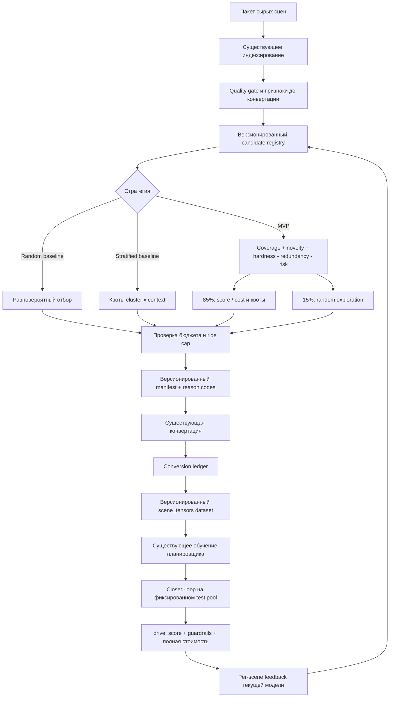

# Дизайн ML-системы отбора данных для обучения планировщика — MVP 1

| Поле | Значение |
| --- | --- |
| Версия | 0.2 |
| Статус | Draft |
| Последнее обновление | 2026-11-07 |

## 1. Цели и предпосылки

### 1.1. Зачем идем в разработку продукта?

#### Бизнес-проблема

Объем сырых сцен движения растет быстрее доступного бюджета на их подготовку и
последующее обучение модели. Каждая сцена должна пройти ресурсоемкое преобразование в
формат обучающего датасета. Полная обработка всех накопленных данных занимает слишком
много времени и вычислительных ресурсов.

Текущий алгоритмический отбор обеспечивает базовое покрытие известных типов ситуаций,
но не учитывает слабые места последней версии модели и может повторно выбирать похожие
сцены. В результате часть бюджета расходуется на данные с низкой дополнительной
ценностью, а редкие и сложные ситуации могут быть представлены недостаточно.

#### Пользователи

Основные пользователи — ML-инженеры, которые формируют обучающие выборки, запускают
обучение моделей планирования и анализируют их качество.

#### Почему станет лучше с ML

Система будет оценивать относительную полезность кандидатов и выбирать набор с учетом
качества, редкости, новизны, разнообразия и стоимости обработки. По мере накопления
обратной связи эвристическую оценку можно дополнить моделью ранжирования, обученной на
фактических ошибках планировщика.

#### Критерий успеха

Основная метрика пилота — средний closed-loop `drive_score` на заранее
зафиксированном test pool. Метрика принимает значения от 0 до 1 и объединяет долю
эпизода без инцидента с прогрессом по маршруту:

\[
drive\_score = survival\_frac \cdot route\_progress\_ratio.
\]

Направление улучшения — рост `drive_score`. Метрики collision, offroad, static
collision и pedestrian collision используются как guardrails и не должны ухудшаться
относительно baseline. Offline loss и ошибки траектории остаются диагностическими:
они помогают объяснять результат, но не заменяют closed-loop проверку.

MVP сравнивается с двумя baseline при одинаковом бюджете конвертации:

1. равновероятным случайным отбором;
2. стратифицированным отбором с балансировкой по известным группам сцен.

Минимальный численный прирост `drive_score`, допустимые границы guardrails и требуемый
доверительный интервал фиксируются после измерения baseline, но до запуска сравнения с
MVP. Это исключает выбор критерия успеха по уже полученному результату.

### 1.2. Бизнес-требования и ограничения

#### Функциональные требования

Система должна:

1. Получать версионированный индекс доступных сцен-кандидатов.
2. Исключать некорректные, уже выбранные и уже обработанные сцены.
3. Рассчитывать оценку полезности без запуска полной подготовки сцены.
4. Формировать набор в пределах заданного вычислительного бюджета.
5. Ограничивать число близких сцен и поддерживать покрытие приоритетных групп.
6. Выпускать версионированный манифест, совместимый с существующим процессом
   преобразования данных.
7. Сохранять версию входных данных, признаков, алгоритма и параметров запуска.
8. Записывать интерпретируемые причины выбора каждой сцены.
9. Принимать обратную связь после преобразования, обучения и оценки модели.
10. Резервировать 15% бюджета для случайной exploration-части из пула после
    quality gate, сохранять вероятность включения и использовать эти сцены в обучении.

#### Нефункциональные требования

- Повторный запуск с одинаковыми входами и параметрами должен давать одинаковый
  результат.
- Операция формирования манифеста должна быть идемпотентной.
- Исходные данные не изменяются системой отбора.
- Схемы входных и выходных данных должны иметь версии и автоматические проверки.
- Для каждой выбранной сцены должна восстанавливаться причина включения.
- Публичный репозиторий не должен содержать исходные данные, модели, учетные данные,
  закрытые адреса или локальные конфигурации.

#### Ограничения

- Точную функцию потерь основной модели нельзя вычислить для неподготовленной сцены.
- Обратная связь появляется с задержкой — после подготовки сцены и запуска модели.
- Измерять точный вклад одной сцены через отдельное переобучение слишком дорого.
- Первая версия ограничена признаками, уже доступными в индексе кандидатов.
- Стоимость обработки может различаться между сценами.
- Последовательные сцены одного заезда могут быть сильно коррелированы.
- Алгоритм отбора меняет распределение накопленного датасета и создает selection bias.
- Существующие процессы индексирования, преобразования и обучения имеют фиксированные
  контракты и не изменяются в рамках проекта.
- Исходные данные являются закрытыми и не публикуются.

#### Ожидаемый результат итерации

Результат — воспроизводимый прототип пакетного отбора, который читает индекс
кандидатов, ведет историю их обработки, выпускает совместимый манифест и позволяет
сравнить стратегии на исторических данных.

#### Пилот и критерии его успеха

Пилот проводится offline на нескольких последовательных временных периодах. Для
случайного baseline, стратифицированного baseline и MVP формируются выборки с
одинаковым бюджетом конвертации. Все стратегии получают один исходный датасет,
checkpoint модели, пул кандидатов, test pool и snapshot доступной обратной связи.

Основной эксперимент — парный одношаговый backtest: каждая стратегия начинает период
из одинакового состояния. Дополнительный многопериодный прогон оценивает накопительный
эффект; в нем состояние и обратная связь каждой стратегии развиваются независимо, но
начальные условия и моменты срезов совпадают.

Пилот считается успешным, если MVP:

- превышает заранее зафиксированный порог прироста `drive_score`;
- не ухудшает collision, offroad, static collision и pedestrian collision guardrails;
- сохраняет результат на приоритетных и редких группах сцен;
- не выбирает повторно обработанные сцены и соблюдает бюджет;
- позволяет воспроизвести манифест, датасет, обучение и оценку;
- сохраняет практический выигрыш после учета scoring, конвертации, обучения и оценки.

Численные пороги фиксируются после baseline и до сравнения с MVP.

### 1.3. Что входит в скоуп проекта и первой итерации

#### Входит в скоуп

- реестр сцен-кандидатов и история их обработки;
- загрузка признаков из существующего индекса;
- фильтрация некорректных и уже обработанных сцен;
- случайный и стратифицированный baseline;
- эвристический score по редкости, покрытию, новизне, качеству и разнообразию;
- ограничения на бюджет и число близких сцен;
- случайная exploration-часть с сохранением вероятности включения;
- версионированный манифест для существующего преобразования данных;
- reason codes и компоненты score для объяснения результата;
- сбор доступной обратной связи по подготовленным сценам;
- полный цикл обучения и closed-loop сравнение стратегий отбора.

#### Не входит в скоуп

- изменение логики существующего индексирования и семантического описания сцен;
- изменение конвертера или формата подготовленного датасета;
- разработка нового фреймворка обучения;
- изменение архитектуры ML-планировщика;
- выбор управляющего действия в реальном времени;
- развертывание online-сервиса в первой итерации;
- сбор новых сырых данных и ручная разметка;
- публикация закрытых данных, моделей и внутренних конфигураций.

#### Качество кода и воспроизводимость

- параметры запуска хранятся как конфигурация;
- входной индекс, признаки, scorer и манифест имеют версии;
- детерминированные операции используют зафиксированный seed;
- проверки качества данных выполняются до расчета score;
- ключевая логика покрывается unit- и интеграционными тестами;
- линтинг и форматирование выполняются Ruff;
- обязательные проверки запускаются через pre-commit;
- каждый эксперимент сохраняет бюджет, разбиение данных и итоговые метрики.

#### Планируемый технический долг

- первая версия использует эвристический score вместо обучаемого ранжирования;
- стоимость сцены сначала может считаться постоянной;
- периодичность запусков задается конфигурацией без автоматического планировщика;
- мониторинг drift и автоматическое дообучение scorer откладываются;
- online-интерфейс и эксплуатационные SLA будут определены после offline-пилота.

### 1.4. Предпосылки решения

1. Единица отбора — одна сцена со стабильным обезличенным идентификатором.
2. До дорогой подготовки доступны признаки качества, семантические категории,
   траекторные характеристики и принадлежность к группе похожих сцен.
3. Существующий процесс принимает список выбранных сцен и формирует датасет для модели.
4. Существующий фреймворк может рассчитать метрики для отдельных подготовленных сцен.
5. Высокая ошибка, редкость или отличие от накопленного распределения могут быть
   признаками полезной сцены, но эта связь требует экспериментальной проверки.
6. Высокая ошибка также может означать поврежденные данные, поэтому quality gate
   применяется раньше оценки сложности.
7. Связанные сцены разделяются по заезду и времени, чтобы избежать утечки между train,
   validation и test.
8. Итоговая полезность стратегии определяется качеством переобученной модели, а не
   только качеством proxy-score.
9. Подготовленный датасет, модель и scorer всегда рассматриваются вместе с их версиями.
10. Первая гипотеза по режиму работы: обновлять реестр по мере поступления данных,
    пересчитывать score пакетно каждый день, формировать бюджет ежедневно или еженедельно
    и полностью пересчитывать оценки при смене модели или схемы признаков.
11. Hardness использует только feedback той версии планировщика, для которой выполняется
    отбор; feedback старых моделей хранится, но не смешивается с текущим score.
12. Случайная exploration-часть входит в обучающий набор и не используется как test.
    Она расширяет покрытие, но не устраняет selection bias.
13. Для честного сравнения отдельно фиксируются бюджет конвертации и полная стоимость
    цикла, включая признаки, scoring, обучение и closed-loop оценку.

## 2. Методология

### 2.1. Постановка задачи

#### Объект, вход и выход

Объект — сцена-кандидат до полной подготовки. Входные признаки первой итерации:

- semantic tags и приоритетный context;
- trajectory cluster и расстояние до его центроида;
- скорость, перемещение, изменение курса, кривизна и ускорение;
- признаки качества и missing flags;
- число и типы агентов рядом с маршрутом;
- частота группы в уже подготовленном датасете;
- состояние предыдущих решений;
- оценка стоимости конвертации;
- hardness по feedback текущей версии планировщика, если он доступен.

Выход — ранжированный версионированный манифест выбранных сцен с итоговым score,
компонентами score, reason codes, вероятностью включения и оценкой стоимости.

#### Формализация

Задача формулируется как constrained ranking и выбор подмножества. Для сцены \(i\):

- \(x_i\) — доступные до подготовки признаки;
- \(c_i\) — оценка стоимости конвертации;
- \(u_i\) — ожидаемая полезность;
- \(s_i\) — score алгоритма.

Необходимо выбрать множество \(S\):

\[
\max_S \sum_{i \in S} u_i, \qquad
\sum_{i \in S} c_i \leq B,
\]

где \(B\) — бюджет конвертации. Дополнительно действуют quality gate, запрет
повторного выбора, квоты покрытия и ограничения на число сцен из одной поездки или
группы близких примеров.

Score MVP:

\[
s_i =
w_1 coverage_i +
w_2 novelty_i +
w_3 hardness_i -
w_4 redundancy_i -
w_5 quality\_risk_i.
\]

Компоненты нормализуются на train-периоде. Веса выбираются по историческим периодам и
замораживаются до итогового test.

#### Hardness для новой сцены

Hardness рассчитывается только по подготовленным сценам, оцененным текущей версией
планировщика:

1. Из того же trajectory cluster и совместимого context выбираются до 20 ближайших
   сцен по нормализованным числовым признакам.
2. Per-scene loss предварительно ограничивается обучающими P05–P95, затем агрегируется
   средним с весами \(1 / (distance + \varepsilon)\).
3. При числе соседей меньше 5 используется медиана cluster/context, затем медиана
   trajectory cluster и глобальная медиана текущей версии модели.
4. Вместе со значением сохраняются `hardness_source`, число соседей и confidence.
5. При смене checkpoint hardness считается устаревшим и пересчитывается.

До появления model feedback компонент hardness принимает нейтральное значение и
низкую confidence; это явно отражается в reason codes.

#### Алгоритм выбора под бюджетом

Бюджет делится на 85% exploitation и 15% exploration.

Exploration выбирается равновероятно из валидного пула после исключения test,
обработанных и уже выбранных сцен. Seed и вероятность включения сохраняются. Эти сцены
входят в обучение, но не используются для оценки качества.

Exploitation выполняется детерминированно:

1. Сначала для каждой приоритетной группы набирается минимальная квота кандидатами с
   максимальным \(s_i / c_i\).
2. Затем остаток бюджета заполняется глобально по \(s_i / c_i\) с проверкой ride cap,
   лимита близких сцен и максимальных квот.
3. При равном значении используются меньшая стоимость и стабильный `scene_id`.
4. Quality gate, исключение test, запрет повторного выбора и общий бюджет являются
   жесткими ограничениями.
5. Если все минимальные квоты несовместимы с бюджетом, бюджет не превышается: квоты
   обрабатываются в заранее заданном порядке приоритета, а дефицит сохраняется как
   `quota_shortfall`.

Пока стоимость сцены не измерена, \(c_i = 1\). После появления conversion ledger
используется прогноз фактического времени или вычислительных ресурсов.

#### Целевая переменная и обратная связь

Прямой прирост итоговой метрики от одной сцены не наблюдается. Для подготовленных сцен
доступны proxy-метки:

- loss текущей модели;
- ошибки траектории и route-related offline-метрики;
- closed-loop инциденты и прогресс;
- успешность, длительность и стоимость конвертации.

Proxy используется для ranking и диагностики. Решение о пользе стратегии принимается
только после обучения модели на выбранном наборе и closed-loop оценки на фиксированном
test pool.

#### Baseline

1. **Random:** равновероятная выборка после одинакового quality gate и исключений.
2. **Stratified:** детерминированная выборка по trajectory cluster и context с ride cap.

Обе стратегии получают тот же бюджет конвертации, seed policy и downstream-процесс,
что и MVP.

#### MVP и дальнейшее развитие

Первый MVP использует интерпретируемый эвристический score. После накопления feedback
рассматривается градиентный бустинг или ranking-модель на табличных признаках. Deep
embeddings добавляются только после проверки, что они доступны дешевле полной
конвертации и дают прирост поверх tags и clusters.

Для обучаемого scorer целевой является нормализованная hardness текущей модели.
Предпочтительна pairwise logistic ranking loss: для отбора важнее корректный порядок,
чем точное значение proxy. Калибровка полезности и стоимости проверяется отдельно.

#### Метрики

| Группа | Метрика | Назначение |
| --- | --- | --- |
| Основная | mean `drive_score`, выше лучше | Итоговое closed-loop качество |
| Guardrails | collision, offroad, static и pedestrian collision rate | Безопасность и корректность |
| Диагностика модели | validation loss, ошибки траектории, `success_rate` | Объяснение результата |
| Scorer | NDCG@K, Recall@K сложных сцен, корреляция score с feedback | Качество ranking |
| Покрытие | доли clusters/tags, близкие дубликаты, quota shortfall | Состав выборки |
| Данные | conversion success rate, возраст feedback, missing rate | Качество контура |
| Стоимость | conversion compute, scoring, training, evaluation, wall time | Полная экономика |

Основной эффект оценивается парной разностью `drive_score` на одних и тех же test
сценах с bootstrap confidence interval. Порог успеха и допустимые изменения guardrails
фиксируются после baseline до оценки MVP.

#### Схема ML-валидации

- Test pool фиксируется заранее, версионируется и не участвует в score или подборе весов.
- Train/validation делятся по поездкам и времени, чтобы связанные сцены не попадали в
  разные части.
- Все стратегии получают одинаковые исходный датасет, checkpoint, candidate pool и
  snapshot feedback.
- В каждом периоде используется только feedback с timestamp не позже момента решения.
- Основной эксперимент — парный одношаговый backtest; многопериодный rollout
  анализируется отдельно.
- Бюджет конвертации одинаков, а полная стоимость цикла показывается дополнительной
  метрикой.
- Обучение повторяется для нескольких seed; по редким группам показываются интервалы и
  абсолютный размер выборки.
- Веса score, квоты и порог успеха не меняются после просмотра test-результата.

### 2.2. Блок-схема решения

Baseline и MVP используют одинаковые quality gate, бюджет конвертации, начальный
датасет, checkpoint и downstream-процесс. Отличаются только правила формирования
манифеста.

### 2.3. Этапы решения задачи

#### Этап 1. Подготовка данных

Результаты исследования приведены в
[EDA-отчете](../reports/eda_report.md). Публичный snapshot содержит только агрегаты и
обезличенные идентификаторы.

##### Данные и сущности

| Данные | Наличие и объем | Качество | Требуемые роли |
| --- | --- | --- | --- |
| Исходные строки сцен | Есть: 8 439 877 строк в 9 батчах | Частично; сцена состоит из нескольких строк | Data Engineer |
| Candidate scenes | Есть: 5 033 189 валидных сцен | Quality gate пройден, причины отказа агрегированы | Data Engineer, ML Engineer |
| Trajectory clusters | Есть: 20 кластеров | Полное покрытие, сильный дисбаланс | ML Engineer |
| Semantic tags и contexts | Есть: 47 tags и 10 contexts | Multi-label, редкие группы требуют контроля размера | ML Engineer, эксперт предметной области |
| Selection state и manifest | Есть: 524 141 сцена | Запись в индекс подтверждена | ML Engineer, MLOps Engineer |
| Conversion ledger | Нет единой витрины | Неизвестны успех, версия, время и стоимость | Data Engineer, MLOps Engineer |
| Per-scene model feedback | Нет связанной витрины | Нельзя построить loss-driven hardness | ML Engineer |
| Независимый test pool | Есть как предпосылка | Требуется аудит состава и версий | ML Engineer |
| Оценка стоимости сцены | Нет | В baseline принимается равной 1 | ML Engineer, MLOps Engineer |

##### Процесс генерации данных

1. Сырые записи поступают пакетами из существующего контура сбора.
2. Записи одной сцены собираются, проверяются маршрут, история, карта, длина и
   локализация.
3. Валидной сцене назначается trajectory cluster по фиксированным центроидам и набор
   semantic tags.
4. Текущий state и правила балансировки формируют selected manifest.
5. Существующий renderer преобразует выбранные сцены в `scene_tensors`.
6. `scene_tensors` читаются существующим training framework.
7. После обучения и оценки feedback должен возвращаться в реестр следующего цикла.

Поступление данных регулярное, обработка выполняется пакетно. Версии входного батча,
схемы, tags, centroids и алгоритма должны сохраняться в manifest.

##### Выводы EDA

- Из 5 055 571 собранной сцены 99,56% проходят quality gate.
- Ride cap оставляет 35,70% кандидатов и является главным фильтром корреляции.
- В selected index попадает 10,41% кандидатов.
- Десять крупнейших trajectory clusters содержат 85,17% сцен.
- Straight-сцены занимают 88,86% исходного пула, но 63,28% selected index.
- Acceptance rate меняется от 1,0% до 20,1% между батчами из-за состава и накопленного
  state.
- Редкие приоритетные contexts принимаются почти полностью, поэтому для них ограничен
  выбор по hardness.
- Числовые признаки имеют тяжелые хвосты и sentinel `-1`; нужны missing flags,
  clipping и устойчивое масштабирование.

##### Достаточность данных

Новых сырых данных для baseline не требуется. Нужен backfill conversion status для
всех 524 141 сцен selected index. Per-scene feedback требуется для всех успешно
подготовленных сцен, участвующих в экспериментах. Hardness считается надежным при
минимум 5 соседях одной версии модели; целевой размер — до 20 соседей на приоритетную
ячейку. Ячейки с меньшим покрытием используют иерархический fallback и помечаются low
confidence.

##### Конфиденциальность

Сырые траектории, карты, идентификаторы сцен и поездок, внутренние пути и конфигурации
остаются в закрытом контуре. В публичный репозиторий попадают только агрегированные
counts, rates, общие названия tags и обезличенные `Bxx`/`Cxx`.

##### Результат этапа

- версионированный candidate registry;
- processing и conversion ledger;
- проверенная схема признаков и quality reason codes;
- обезличенный EDA snapshot и отчет;
- зафиксированные train/validation/test splits;
- baseline оценки объема и стоимости.

#### Этап 2. Подготовка стратегий отбора и прогнозных моделей

##### Baseline

- Random и stratified стратегии работают поверх одного quality gate.
- Stratified baseline балансирует trajectory cluster и context, применяет ride cap.
- Стоимость сцены до появления ledger считается равной 1.
- Manifest сохраняет seed, версии входа, параметры и вероятность включения.

##### MVP

Эвристический scorer объединяет coverage, novelty, hardness, redundancy и quality
risk. Для каждой сцены сохраняются компоненты score и reason codes. Обучаемая
ranking-модель появляется только после накопления version-aligned feedback.

##### Предобработка и feature engineering

- sentinel значения преобразуются в missing flags;
- числовые признаки ограничиваются обучающими перцентилями и масштабируются;
- clusters и tags кодируются как категориальные и multi-hot признаки;
- связанные сцены группируются по поездке и времени;
- feedback старых checkpoint не смешивается с текущей моделью;
- стоимость и conversion status становятся отдельными признаками после появления
  ledger.

##### Обучение и подбор параметров

Веса эвристики и гиперпараметры будущего scorer выбираются только на последовательных
исторических train/validation периодах. Для ranking-модели первым кандидатом является
градиентный бустинг с pairwise loss: он интерпретируем, работает с табличными и
категориальными признаками и дешевле embedding-инференса. Подбор ограничивается
небольшим заранее заданным пространством и учитывает стабильность по периодам.

##### Анализ и интерпретация

Для heuristic MVP показываются компоненты score, сработавшие квоты и reason codes. Для
обучаемой модели дополнительно оцениваются permutation importance или SHAP на закрытых
данных, калибровка по группам и ошибки на редких contexts. Объяснение не публикует
данные отдельной сцены.

##### Риски и снижение

| Риск | Снижение |
| --- | --- |
| Proxy не связан с итоговым качеством | Полный цикл обучения и closed-loop оценка |
| Feedback устарел после смены модели | Version-aligned хранение и пересчет hardness |
| Редким группам не хватает примеров | Confidence, fallback и exploration |
| Scorer переобучился на период | Time-based validation и замороженный test |
| Embeddings слишком дороги | Сначала табличный baseline и измерение полной стоимости |
| Selection bias | Независимый test pool и сохранение inclusion probability |

##### Результат этапа

Воспроизводимые реализации random, stratified и MVP scoring; зафиксированные признаки,
веса, seed, метрики и validation protocol; отчет о ranking-качестве и стоимости.

#### Этап 3. Оптимизация выбора под бюджетом

Применяется двухфазный детерминированный greedy selection: сначала минимальные квоты,
затем заполнение по `score / cost`. Hard constraints — quality, бюджет, исключение
test, запрет повторного выбора, ride cap и лимит близких сцен. Невыполнимые квоты не
увеличивают бюджет и записываются как `quota_shortfall`.

Результат — manifest с версией state, оценкой стоимости, reason codes, inclusion
probability и отчетом о выполнении квот.

#### Этап 4. Конвертация и версионирование датасета

Логика существующего renderer не изменяется. Для каждой сцены фиксируются статусы
`planned/running/succeeded/failed`, версия конвертера, checksum результата,
длительность и вычислительная стоимость. Повторный запуск идемпотентен.

Dataset version определяется manifest, версией converter, схемой `scene_tensors` и
списком успешных сцен. Ошибки не удаляются молча и не заменяются другими сценами без
новой версии.

Результат — неизменяемая версия датасета и полный conversion ledger.

#### Этап 5. Обучение и closed-loop оценка

Каждая стратегия использует одинаковые training framework, начальный checkpoint,
конфигурацию, seed policy и число шагов. Модель связывается с dataset version, commit,
config и checkpoint.

Closed-loop выполняется на фиксированном test pool и одинаковой конфигурации
симулятора. Основная метрика — `drive_score`; guardrails и результаты по редким
группам публикуются рядом. Offline loss используется для диагностики.

Результат — сопоставимый model card каждой стратегии и парный отчет метрик.

#### Этап 6. Feedback и мониторинг

Per-scene loss, closed-loop события, conversion status и стоимость связываются с
версиями сцены, датасета и модели. Dashboard показывает:

- воронку данных и причины отказов;
- drift clusters, tags и числовых признаков;
- coverage и quota shortfall;
- conversion success rate и стоимость;
- `drive_score`, guardrails и разрезы по группам;
- возраст и версию feedback.

Результат — versioned feedback snapshot для следующего цикла отбора.

#### Этап 7. Решение о пилоте

Перед просмотром MVP фиксируются минимальный прирост `drive_score`, guardrails,
бюджет и правила статистического сравнения. Решение принимает во внимание качество,
полную стоимость и воспроизводимость.

Если MVP устойчиво лучше baseline, он становится новой рабочей стратегией. Если proxy
ranking улучшается, а `drive_score` нет, меняются target или feedback, но не критерий
успеха постфактум.

## 3. Подготовка пилота

### 3.1. Способ оценки

Основной дизайн — парный одношаговый backtest на нескольких временных срезах. Для
каждого среза стратегии получают одинаковые начальные данные и модель, формируют
manifest, проходят конвертацию и обучение, затем оцениваются на одном test pool.
Разность `drive_score` агрегируется по срезам и seed.

Дополнительный многопериодный rollout проверяет накопительный эффект и насыщение
ячеек. Его результат не смешивается с одношаговой оценкой.

### 3.2. Что считаем успешным пилотом

- `drive_score` превышает baseline на заранее установленный порог;
- bootstrap confidence interval поддерживает направление улучшения;
- guardrails не выходят за зафиксированные пределы;
- результат сохраняется на приоритетных группах;
- manifest, dataset и модель воспроизводимы;
- полная стоимость не уничтожает выигрыш от уменьшения объема конвертации.

### 3.3. Вычислительный бюджет

Сначала baseline измеряет отдельно:

1. стоимость признаков и scoring;
2. стоимость конвертации;
3. стоимость обучения;
4. стоимость closed-loop оценки;
5. wall time полного цикла.

После этого фиксируются размер батча, число seed и численный порог пилота. Основное
сравнение использует одинаковый conversion budget; итоговый отчет показывает также
полную стоимость.

## 4. Риски и открытые вопросы

### 4.1. Риски

| Риск | Последствие | Снижение риска |
| --- | --- | --- |
| Высокая ошибка вызвана дефектом данных | Выбирается шум | Quality risk и reason codes |
| Отбираются только сложные сцены | Теряется обычное распределение | Квоты и 15% exploration |
| Много похожих сцен | Бюджет расходуется на дубликаты | Grouping, ride cap и similarity cap |
| Proxy не связан с `drive_score` | Ranking не улучшает модель | Полный paired pilot |
| Selection bias | Неверная оценка пользы | Независимый test и inclusion probability |
| Drift данных или модели | Hardness устаревает | Версии feedback и пересчет |
| Невыполнимые квоты | Скрытое превышение бюджета | Приоритеты и quota shortfall |
| Утечка между train и test | Завышенная оценка | Group/time split и реестр test |
| Неучтенная стоимость scoring | Нет практического выигрыша | Полная стоимость цикла |
| Ошибка конвертации теряется | Невоспроизводимый датасет | Идемпотентный conversion ledger |

### 4.2. Открытые вопросы

1. Какой численный прирост `drive_score` и пределы guardrails следуют из baseline?
2. Какой conversion budget доступен за один период?
3. Какая единица лучше предсказывает стоимость: сцена, длительность или размер?
4. Какие признаки гарантированно доступны до конвертации во всех периодах?
5. Дают ли дешевые embeddings прирост поверх tags и clusters?
6. Какие минимальные и максимальные квоты нужны приоритетным группам?
7. Какой объем version-aligned feedback достаточен для обучаемого scorer?
8. Как долго хранить feedback старых моделей и selection state?
9. Какие причины conversion failure безопасно использовать как признаки?

## 5. Журнал решений

| Дата | Решение | Обоснование |
| --- | --- | --- |
| 2026-10-17 | Реализовать систему как независимый слой отбора | Существующие процессы имеют подходящие контракты |
| 2026-10-17 | Не требовать model loss до конвертации | Для новой сцены он недоступен |
| 2026-10-17 | Сравнивать стратегии при одинаковом бюджете | Так измеряется практическая ценность отбора |
| 2026-11-07 | Выбрать `drive_score` основной метрикой | Метрика учитывает прогресс и отсутствие инцидента |
| 2026-11-07 | Использовать 85% exploitation и 15% exploration | Нужны баланс качества и поиск новых типов |
| 2026-11-07 | Сохранять inclusion probability | Exploration не устраняет selection bias |
| 2026-11-07 | Основной pilot сделать парным одношаговым | Стратегии получают одинаковую историю |
| 2026-11-07 | Учитывать conversion и полную стоимость отдельно | Scoring и evaluation имеют собственные расходы |
| 2026-11-07 | Публиковать только обезличенные агрегаты | Сырые данные остаются в закрытом контуре |
