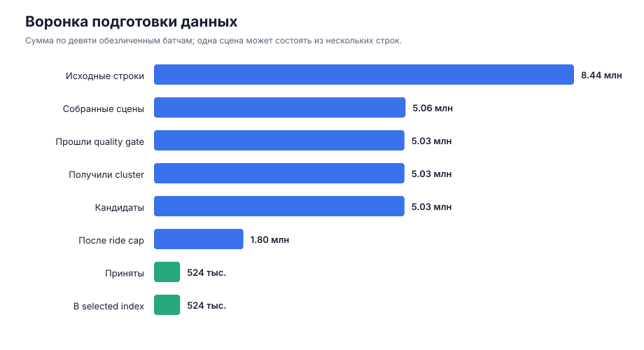
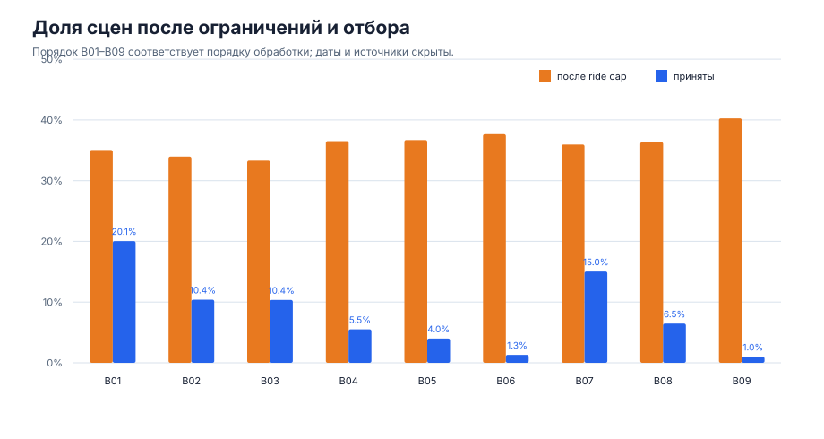
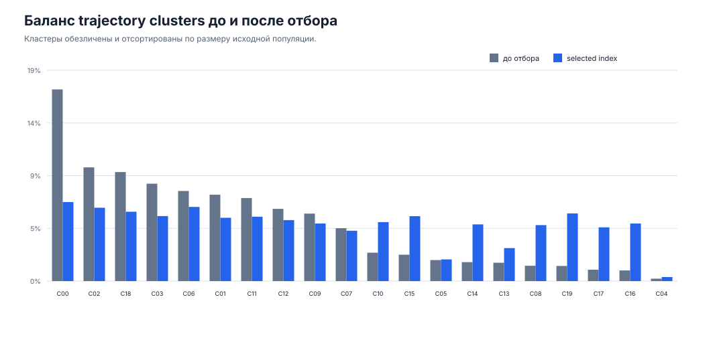
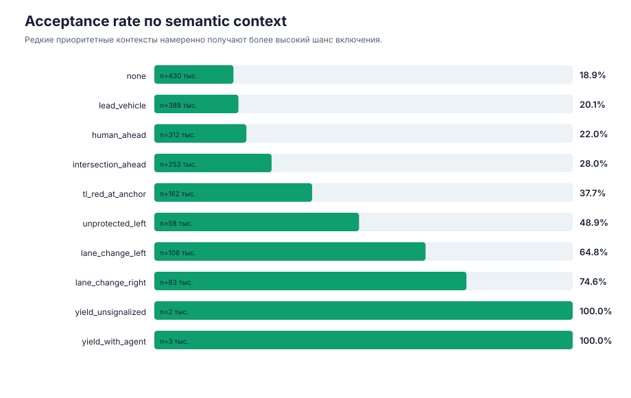

# EDA данных для отбора сцен

## Цель и границы анализа

Цель EDA — проверить, достаточно ли доступных данных для разработки системы отбора,
какие ограничения качества действуют до дорогой конвертации и как текущая стратегия
меняет состав selected index.

Анализ выполнен на обезличенном агрегированном срезе девяти батчей. В публичный
репозиторий включены только количества, доли, общие semantic tags и обезличенные
идентификаторы батчей и trajectory clusters. Сырые сцены, идентификаторы поездок,
внутренние адреса и конфигурации отсутствуют.

## Состав и объем данных

Общая воронка содержит:

| Этап | Количество | Доля от предыдущего релевантного этапа |
| --- | ---: | ---: |
| Исходные строки | 8 439 877 | — |
| Собранные сцены | 5 055 571 | строки не равны сценам |
| Прошли quality gate | 5 033 189 | 99,56% |
| Получили trajectory cluster | 5 033 189 | 100% |
| Кандидаты для отбора | 5 033 189 | 100% |
| После ограничения сцен одной поездки | 1 796 909 | 35,70% кандидатов |
| Приняты в selected index | 524 141 | 10,41% кандидатов |
| Записаны в индекс | 524 141 | 100% принятых |

Количество валидных кандидатов значительно превышает размер selected index. Для
baseline дополнительный сбор сырых сцен не требуется. Главные ограничения находятся
в устранении коррелированных примеров, балансировке состава и стоимости последующей
конвертации.

## Качество и стабильность батчей

Доля сцен, прошедших quality gate, находится в диапазоне от 99,27% до 99,74%. Фильтр
проверяет наличие необходимой истории, маршрута и карты, достаточную длину сцены,
стабильность локализации и отсутствие некорректных столкновений в ground truth.

Низкая доля отбраковки означает, что базовые технические дефекты не являются главным
ограничением объема. При этом агрегированная воронка не показывает причины каждого
отказа. Для эксплуатации нужен reason code quality gate на уровне сцены.

Ограничение числа сцен из одной поездки оставляет 33,3–40,3% кандидатов каждого батча.
Итоговая доля отбора меняется сильнее — от 1,0% до 20,1%.

Различие acceptance rate ожидаемо для stateful-алгоритма: новые батчи заполняют только
оставшийся дефицит в ячейках распределения. Поэтому последовательные эксперименты
должны получать одинаковый начальный state и только ту обратную связь, которая была
доступна к моменту решения. Простое сравнение двух батчей смешивает эффект стратегии,
состав источника и накопленную историю.

## Состав trajectory clusters

В срезе присутствуют все 20 кластеров. Десять крупнейших содержат 85,17% валидных
сцен, что подтверждает сильный дисбаланс исходного пула.

| Тип траектории | Доля исходных сцен | Доля selected index | Acceptance rate |
| --- | ---: | ---: | ---: |
| Straight | 88,86% | 63,28% | 7,42% |
| Right | 6,54% | 19,91% | 31,72% |
| Left | 4,60% | 16,81% | 38,01% |

Текущий отбор снижает доминирование прямолинейных сцен и повышает представленность
поворотов. Это улучшает баланс, однако само по себе не доказывает прирост качества
планировщика. Для такого вывода нужна связь выбранной сцены с версией датасета, моделью
и результатами фиксированной closed-loop оценки.

## Semantic tags и приоритетные contexts

Теги являются multi-label и описывают движение ego, элементы маршрута, сигналы
светофора и окружающих агентов. Частые признаки отражают обычное движение, а редкие
сценарии встречаются на порядки реже. Например, два приоритетных сценария представлены
примерно 3 и 5 тысячами сцен на фоне более чем 5 миллионов валидных кандидатов.

Текущий алгоритм использует приоритетный context и trajectory cluster как ячейку
балансировки:

| Context | Кандидаты | Acceptance rate |
| --- | ---: | ---: |
| none | 429 521 | 18,92% |
| lead_vehicle | 387 973 | 20,10% |
| human_ahead | 312 498 | 22,00% |
| intersection_ahead | 253 472 | 28,04% |
| tl_red_at_anchor | 161 609 | 37,73% |
| unprotected_left | 57 622 | 48,94% |
| lane_change_left | 105 773 | 64,84% |
| lane_change_right | 83 255 | 74,61% |
| yield_unsignalized | 2 264 | 100% |
| yield_with_agent | 2 922 | 100% |

Редкие приоритетные contexts почти полностью принимаются, а частые — прореживаются.
Это соответствует цели балансировки. Одновременно полное принятие редкой ячейки
означает, что для неё уже нет запаса выбора по hardness или качеству: полезность будет
ограничена всеми доступными примерами этого типа.

## Числовые признаки

Для одного крупного батча из 692 957 валидных сцен рассмотрены перцентили признаков:

| Признак | P05 | P50 | P95 | Вывод |
| --- | ---: | ---: | ---: | --- |
| Средняя скорость, м/с | 1,70 | 5,78 | 14,42 | Представлены медленные и скоростные режимы |
| Перемещение, м | 21,18 | 73,45 | 187,40 | Большой разброс длины фактического движения |
| Изменение курса, градусы | −70,21 | −0,11 | 59,93 | Большинство сцен прямые, хвосты содержат повороты |
| Максимальная кривизна | 0,0009 | 0,0055 | 0,1503 | Распределение имеет выраженный правый хвост |
| Минимальное ускорение, м/с² | −1,78 | −0,46 | −0,001 | Резкие торможения редки |
| Число машин в радиусе | 1 | 10,97 | 32,02 | Есть как свободные, так и плотные сцены |

Некоторые признаки используют sentinel `-1` для отсутствующего объекта. Их нельзя
обрабатывать как обычное числовое значение: требуется отдельный missing-флаг. Максимумы
нескольких геометрических признаков сильно удалены от P95, поэтому перед использованием
в scorer нужны проверки единиц измерения, clipping и устойчивое масштабирование.

## Выявленные ограничения данных

1. **Нет единого conversion ledger.** Равенство числа принятых сцен и строк индекса
   подтверждает запись манифеста, но не успешное получение `scene_tensors`.
2. **Нет измеренной стоимости сцены.** Бюджет пока фактически задается количеством,
   хотя время и ресурсы конвертации могут различаться.
3. **Нет per-scene feedback модели.** Нельзя проверить связь текущих tags и clusters с
   model loss или closed-loop ошибками и обучить loss-driven scorer.
4. **Acceptance зависит от порядка.** Накопленный state должен версионироваться вместе
   с алгоритмом, параметрами и входным батчем.
5. **Multi-label теги нельзя суммировать.** Для оценки покрытия используются fire rate
   и отдельные срезы, а не сумма сцен по тегам.
6. **Агрегаты скрывают причины брака.** Нужен reason code для каждой отклоненной сцены.

## Выводы для следующей итерации

- Объема данных достаточно для baseline и MVP; приоритет — качество учета и обратной
  связи, а не дополнительный сбор.
- Baseline должен включать случайный и стратифицированный отбор при одинаковом бюджете.
- MVP должен учитывать дисбаланс, ограничение связанных сцен и стоимость, но итоговую
  пользу нужно проверять после обучения на фиксированном test pool.
- Основная метрика пилота — closed-loop `drive_score`; collision, offroad и pedestrian
  collision используются как guardrails.
- До loss-driven отбора необходимо связать selected manifest, conversion ledger,
  версию датасета, checkpoint модели и per-scene feedback.
- Случайные 15% бюджета используются для exploration и входят в обучение. Они не
  устраняют selection bias и не заменяют независимый test pool.
